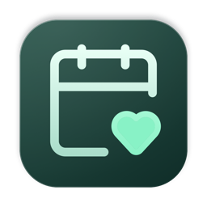
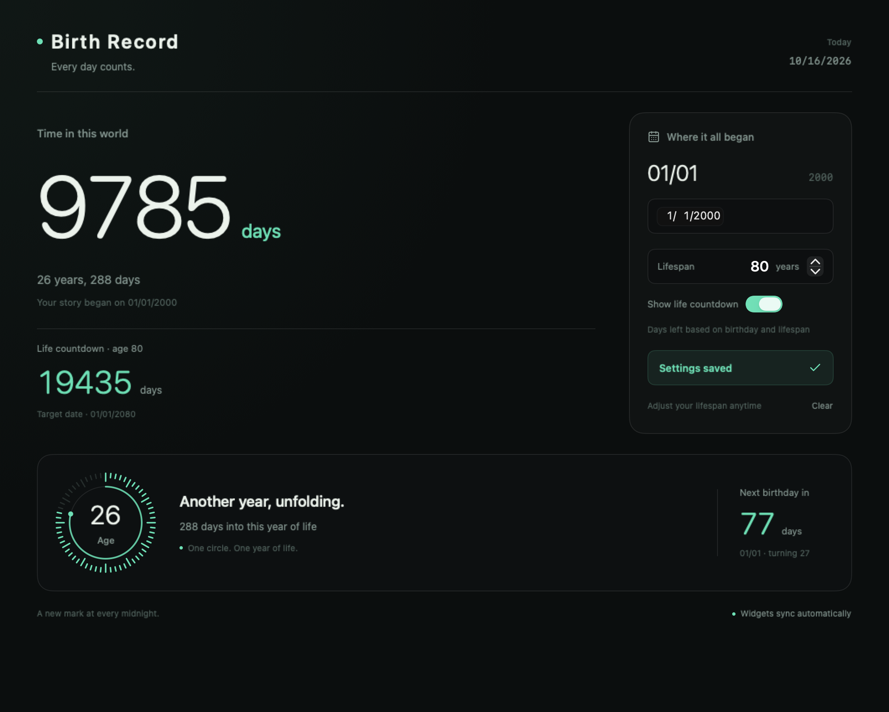
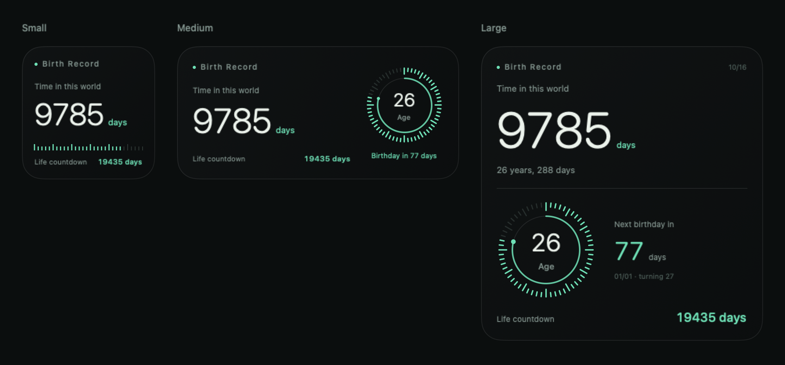

# Birth Record

[English](README.md) · [简体中文](README.zh-CN.md)



Every day counts.

A native macOS birthday tracker built with SwiftUI and WidgetKit. A quiet dark green interface shows your days alive, age, birthday progress, and the days until your next birthday.

## Screenshots

### App



Current app views rendered with sample data and the optional life countdown enabled. For Chinese screenshots, see the [Simplified Chinese README](README.zh-CN.md#界面截图).

### Widget previews



Previews of the three widget sizes using sample data. Widget availability and synchronization depend on signing permissions; see [Widgets and shared storage](#widgets-and-shared-storage).

## Features

- Days alive counted by calendar day, with your birthday counted as day zero.
- A circular timeline for the year between birthdays.
- An optional life countdown based on a lifespan of 1–150 years, disabled by default.
- Live previews while editing; changes are stored when you save.
- Leap-day birthdays use the last day of February in non-leap years.
- Simplified Chinese and English, including dates, accessibility text, app names, and English plurals.
- Small, medium, and large WidgetKit implementations, subject to the signing limitations below.
- Local storage, with no account, server, analytics SDK, or advertising SDK.

## Download

Download the universal DMG from [Releases](https://github.com/leon-su7/BirthdayDays/releases), open it, and drag the app into Applications. Requires macOS 14 or later. One universal package runs natively on both Apple Silicon (`arm64`) and Intel (`x86_64`); macOS automatically selects the right architecture.

The app is distributed without an Apple developer certificate or notarization. macOS Gatekeeper may block the first launch. Verify the source and checksum, and see [Apple's official guidance](https://support.apple.com/en-us/102445).

Keep the DMG and its checksum file in the same directory:

```bash
shasum -a 256 -c BirthdayDays-1.0-universal.dmg.sha256
```

Adjust the filename for the version you download.

## Build

Requires macOS, Xcode 16 or later, and [XcodeGen](https://github.com/yonaskolb/XcodeGen). Complete Xcode's first-launch setup and configure its command-line tools, then run:

```bash
git clone https://github.com/leon-su7/BirthdayDays.git
cd BirthdayDays
brew install xcodegen
./Scripts/build-local.sh
open .build/DerivedData/Build/Products/Debug/诞生记录.app
```

Build a universal Release DMG and SHA-256 checksum:

```bash
./Scripts/package-dmg.sh
```

Both files are written to `dist/`. The build does not require an Apple account, development team, or signing certificate. Apple Silicon binaries may contain an ad hoc signature generated automatically by the system linker; the scripts do not invoke `codesign` or notarization services.

To work in Xcode, run `xcodegen generate` and open `BirthdayDays.xcodeproj`. The generated project is ignored by Git; edit `project.yml` for persistent project changes. GitHub Actions uses the same DMG packaging script.

## Language

The app follows your macOS preferred language. You can also select English or Simplified Chinese for this app in **System Settings → General → Language & Region → Applications**, then relaunch it. The app and widget share `Resources/Localizable.xcstrings`.

## Widgets and shared storage

WidgetKit and App Group containers depend on macOS signing and entitlement checks. The default package is intended for using the main app; desktop widgets and shared storage are not guaranteed to work without developer signing. When the shared container is unavailable, the main app uses local UserDefaults and displays “Widget sync unavailable”.

The complete widget implementation is included. To enable sharing in your own signed build, configure the same development team for both targets, enable signing, and configure matching App Group entitlements in `project.yml`.

## Contributing

Open an [issue](https://github.com/leon-su7/BirthdayDays/issues) or submit a pull request. Include your macOS and Xcode versions, reproduction steps, and expected behavior. Run `./Scripts/package-dmg.sh` before submitting. Follow the existing dark theme and use Lucide icons. Do not include real birthdays, certificates, or personal information in issues, screenshots, or commits.

## License

[MIT](LICENSE). Lucide icon paths retain their ISC / MIT notices; see [THIRD_PARTY_NOTICES.md](THIRD_PARTY_NOTICES.md) and [Lucide-LICENSE.txt](Sources/App/Lucide-LICENSE.txt).
